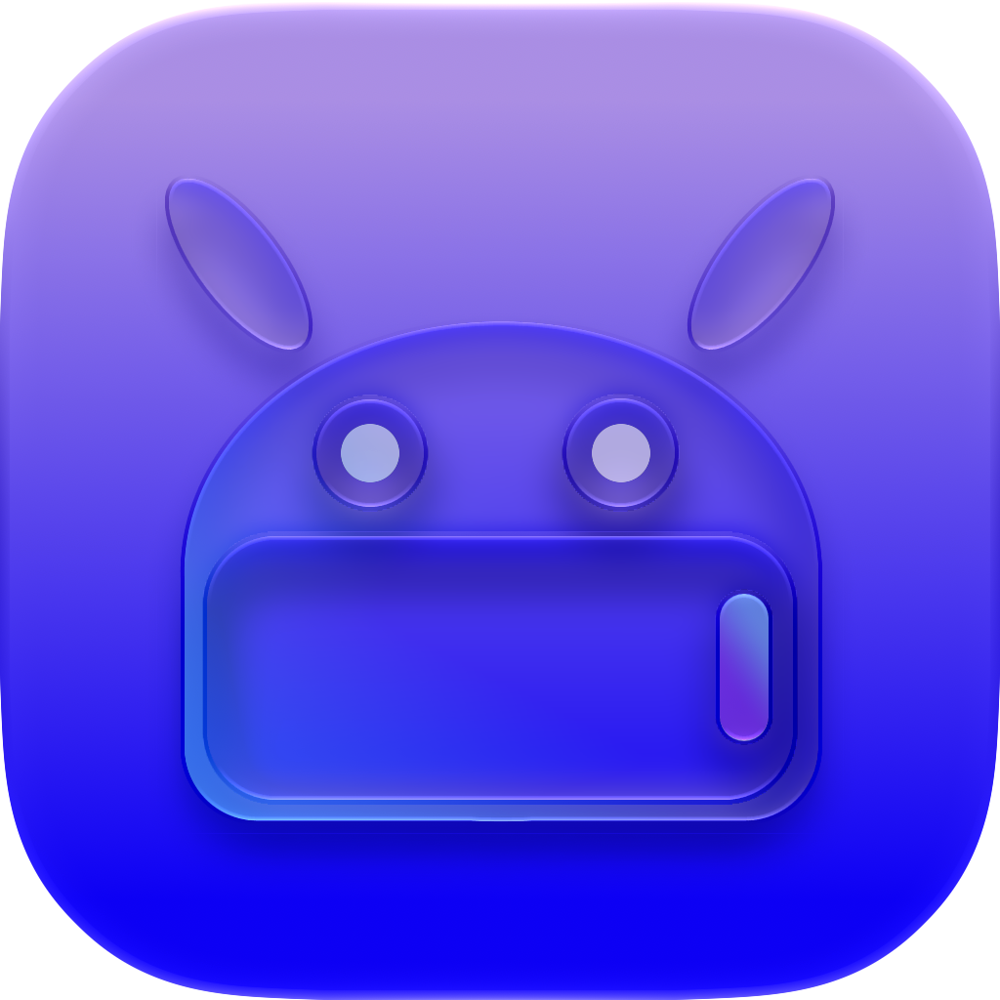

<p align="center">
  
</p>

<h1 align="center">Husk</h1>

<p align="center">Android apps and games on your iPhone.</p>

<p align="center">
  <a href="https://itslevii.dev/docs/install">Install</a>
  ·
  <a href="https://itslevii.dev/husk">Compatibility</a>
  ·
  <a href="https://itslevii.dev">Website</a>
  ·
  <a href="https://github.com/Leviidev/Husk/releases">Releases</a>
</p>

<p align="center">
  <a href="https://github.com/Leviidev/Husk/releases"></a>
  <a href="LICENSE"></a>
</p>

Add an APK, tap it, and it opens full-screen.

- **Translation layer** — the game’s own 64-bit Android code runs on the iPhone. Husk stands in for Android around it (C library, Java, GL, Vulkan, audio, input). No Android boot; a game starts in seconds.
- **Emulation** — a full LineageOS guest under QEMU, for apps the translation layer cannot run yet.
- **PS4** — fake packages and game folders on iOS 17.4+.

## Install

Sideload with SideStore, AltStore, or TrollStore. iOS 15.5 or later.

**Guide:** [itslevii.dev/docs/install](https://itslevii.dev/docs/install)

Add this source in SideStore or AltStore (Sources › +). It also lists AetherPS4, Utsuro, Podium and Fathom:

```
https://itslevii.dev/repo.json
```

Or download `Husk.ipa` from [Releases](https://github.com/Leviidev/Husk/releases).

Games need [JIT](https://itslevii.dev/docs/jit), or they can run from [Play without JIT](https://itslevii.dev/docs/play-without-jit) after you import the certificate that installed Husk.

## Screenshots

<table>
  <tr>
    <td align="center"><br><sub>GTA: San Andreas</sub></td>
    <td align="center"><br><sub>Minecraft Dungeons</sub></td>
  </tr>
  <tr>
    <td align="center" width="33%"><br><sub>Library</sub></td>
    <td align="center" width="33%"><br><sub>Game Settings</sub></td>
    <td align="center" width="33%"><br><sub>Settings</sub></td>
  </tr>
</table>

## Building

On a Mac with Xcode, plus `meson`, `ninja`, `pkg-config`, `python3`, `xcodegen`, `qemu-img`, and a Rust toolchain with `aarch64-apple-ios`:

```sh
./scripts/ci_build.sh
```

That produces `build/Husk.ipa`. Later app-only rebuilds: `./scripts/package_ipa.sh` → `~/Desktop/Husk.ipa`.

## HUNG APK PLAYER development

This workspace adds a real `iconv` compatibility bridge, native-import evidence,
per-app startup diagnostics, portable APK/DEX/ELF analysis and QA profiles.
Game compatibility remains unverified until tested on a device.

- [Current architecture](docs/07-hung-architecture.md)
- [Changes, Windows tests, cloud build and iPhone installation](docs/08-hung-delivery.md)
- [Compatibility matrix and outstanding device tests](docs/09-hung-qa.md)
- [iPhone cutouts, frame allocation checks and gameplay crash evidence](docs/12-iphone-viewport-stability.md)
- [Full-screen background with cutout-aware game controls](docs/13-fullscreen-safe-controls.md)
- [VHTG quest-only cutout positioning](docs/14-vhtg-quest-only-cutout.md)
- Manual iOS build: [HUNG APK PLAYER workflow](.github/workflows/hung-ios.yml)

```sh
python tools/hung_compat.py analyze TruTien.apk --out build/trutien-report.json
python tools/hung_compat.py diagnose startup.log --out build/startup-diagnosis.json
python tests/run_portable.py
```

Windows C tests need a compiler; the tested invocation is documented in the
delivery guide. The cloud workflow builds Android support from this checkout and
bootstraps hash-pinned Android resources from upstream Husk 3.3. Its Android
variant omits the optional PS4 module. The modified IPA was built successfully
in [run 41812380941](https://github.com/hungtm200401-bot/Husk/actions/runs/41812380941),
with passing Linux/macOS QA. Download the IPA and corresponding source from
the [build artifact](https://github.com/hungtm200401-bot/Husk/actions/runs/41812380941/artifacts/13312987970).
Device launch and game compatibility remain untested.

## Licence

GPL-2.0-or-later. Husk links QEMU (GPLv2), so the shipped binary is a combined GPLv2 work. It cannot go on the App Store. See [docs/01-licensing.md](docs/01-licensing.md).
