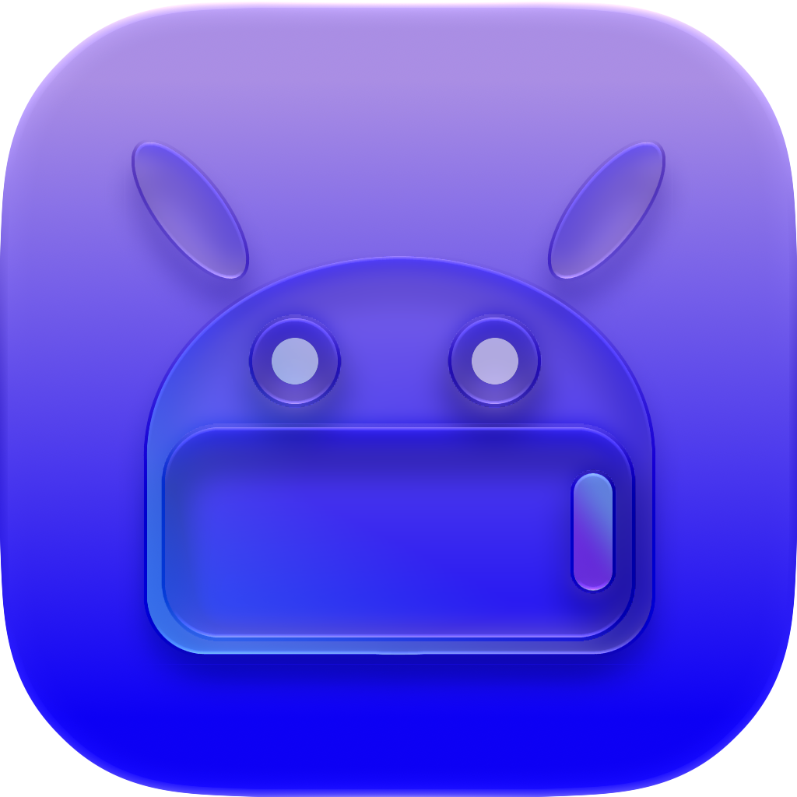

<p align="center">
  
</p>

<h1 align="center">Husk</h1>

<p align="center">Android apps and games on your iPhone.</p>

<p align="center">
  <a href="https://itslevii.dev/docs/install">Install</a>
  ·
  <a href="https://itslevii.dev/husk">Compatibility</a>
  ·
  <a href="https://itslevii.dev">Website</a>
  ·
  <a href="https://github.com/Leviidev/Husk/releases">Releases</a>
</p>

<p align="center">
  <a href="https://github.com/Leviidev/Husk/releases"></a>
  <a href="LICENSE"></a>
</p>

Add an APK, tap it, and it opens full-screen.

- **Translation layer** — the game’s own 64-bit Android code runs on the iPhone. Husk stands in for Android around it (C library, Java, GL, Vulkan, audio, input). No Android boot; a game starts in seconds.
- **Emulation** — a full LineageOS guest under QEMU, for apps the translation layer cannot run yet.
- **PS4** — fake packages and game folders on iOS 17.4+.

## Install

Sideload with SideStore, AltStore, or TrollStore. iOS 15.5 or later.

**Guide:** [itslevii.dev/docs/install](https://itslevii.dev/docs/install)

Add this source in SideStore or AltStore (Sources › +). It also lists AetherPS4, Utsuro, Podium and Fathom:

```
https://itslevii.dev/repo.json
```

Or download `Husk.ipa` from [Releases](https://github.com/Leviidev/Husk/releases).

Games need [JIT](https://itslevii.dev/docs/jit), or they can run from [Play without JIT](https://itslevii.dev/docs/play-without-jit) after you import the certificate that installed Husk.

## Requirements

Any iPhone or iPad running **iOS 15.5 or later** can install Husk (that is the deployment target in `src/app/project.yml`). What decides whether an app actually runs is the list below, not the chip.

| | |
|---|---|
| **iOS** | 15.5 or later. PS4 games need 17.4 or later. |
| **JIT** | Every Android app and game needs it, however it is turned on: [JIT](https://itslevii.dev/docs/jit). Neither the translation layer nor the emulator starts without it. |
| **CPU code** | `arm64-v8a` APKs run on the translation layer. An APK with only `armeabi-v7a` libraries needs the emulator, because Apple's CPUs have not executed AArch32 since the A11 (see [docs/04-translation-layer.md](docs/04-translation-layer.md)). |
| **RAM** | The deciding factor. Android runs 64-bit in Husk's own process, and jetsam closes the app when its footprint gets too large. Close other apps before starting a big game. |
| **Storage** | Apps and their data live inside Husk. The full Android system is about 2 GB to download and about 4 GB once expanded, on top of your apps and their saves. |
| **Google** | There are no Play services. Apps that require a Google account or Play services cannot work. |

Most of the issues in this tracker come from the JIT row: JIT lasts only as long as Husk is running, so it has to be turned on again after iOS closes the app or after it is swiped away. Settings › Help lists what to do when it fails.

## Screenshots

<table>
  <tr>
    <td align="center"><br><sub>GTA: San Andreas</sub></td>
    <td align="center"><br><sub>Minecraft Dungeons</sub></td>
  </tr>
  <tr>
    <td align="center" width="33%"><br><sub>Library</sub></td>
    <td align="center" width="33%"><br><sub>Game Settings</sub></td>
    <td align="center" width="33%"><br><sub>Settings</sub></td>
  </tr>
</table>

## Building

On a Mac with Xcode, plus `meson`, `ninja`, `pkg-config`, `python3`, `xcodegen`, `qemu-img`, and a Rust toolchain with `aarch64-apple-ios`:

```sh
./scripts/ci_build.sh
```

That produces `build/Husk.ipa`. Later app-only rebuilds: `./scripts/package_ipa.sh` → `~/Desktop/Husk.ipa`.

## Licence

GPL-2.0-or-later. Husk links QEMU (GPLv2), so the shipped binary is a combined GPLv2 work. It cannot go on the App Store. See [docs/01-licensing.md](docs/01-licensing.md).
