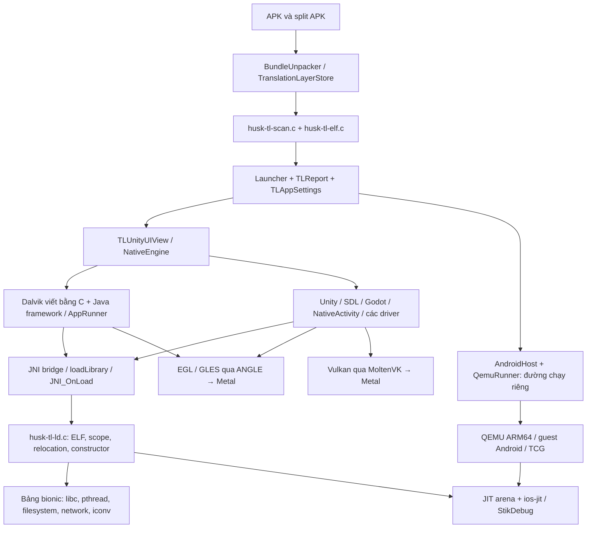

# HUNG APK PLAYER: kiến trúc theo mã nguồn

Đọc và đối chiếu ngày 2026-11-04. Tài liệu `00-architecture.md` và
`04-translation-layer.md` mô tả các mốc cũ; không dùng chúng làm bằng chứng
rằng một APK hiện đã tương thích.

`TLReport.nativeEngine` chọn driver; SDL thông thường hiện đi qua `.java`
để Activity thực thi code chuẩn bị dữ liệu. `.sdl` HLE là đường khác, dùng
cho một số port. Vì vậy log chỉ ở SDL driver không đủ chẩn đoán mọi game SDL.

`lookup_for()` tìm symbol trong thư viện và dependency scope trước, rồi mới
`tl_bionic_find()`. Resolver không tự fallback sang toàn bộ symbol Darwin:
ABI của FILE, va_list, errno, pthread và long double có khác biệt.
`bind_symbol()` cấp stub hiện hữu cho strong import chưa có; thông báo lúc
load và thông báo khi stub thực sự được gọi là hai mức bằng chứng khác nhau.

JNI được xử lý trong `husk-tl-jni*.c`; Java interpreter và Android services
ở `husk-tl-dvm*.c` cùng `src/java-framework/`. `husk-tl-bionic-io.c` ánh xạ
đường dẫn APK, data, OBB và shared storage; `husk-tl-bionic-net.c` ánh xạ socket
và DNS. Audio dùng `husk-tl-audio.c`, OpenSL ES và CoreAudio; input dùng các
driver cùng `HuskGamepad.swift`/`VirtualPad.swift`.

Luồng QEMU cần guest image và boot Android; luồng translation không boot
Android. Không tự đổi luồng hoặc nhập/chuyển dữ liệu của người dùng.

## Ưu tiên dựa trên bằng chứng

1. **Đã sửa mã, đã test host:** thiếu bảng iconv và dịch errno.
2. **Cần log thiết bị mới:** `_Unwind_*` được báo thiếu nhưng chưa có bằng
   chứng được gọi; không thể kết luận gây treo hoặc thay bằng unwinder Mach-O
   khi chưa xử lý/kiểm thử ELF exception tables.
3. **Cần đo thực tế:** JNI exceptions, tài nguyên, mạng, graphics features.
4. **Build:** script CI gốc thiếu bước cung cấp Java runtime/android-system
   và PS4 dylib từ máy tác giả; cần nguồn đầu vào có provenance rõ ràng.

JIT, entitlement và Bundle ID giữ nguyên. Các wrapper iconv không sửa APK,
không can thiệp server/DRM/chống gian lận. SDL heartbeat chỉ báo native entry
và số frame, không xác nhận engine sẵn sàng hoặc gameplay chạy được.
